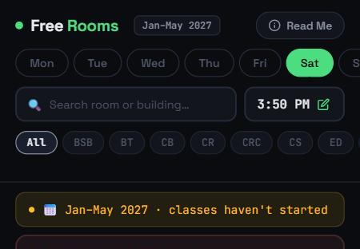

# Design: Jan–May 2027 semester update

Goes with [spec.md](spec.md). Status: **built** (see spec.md "Decisions").

## 1. Data pipeline (`scripts/build_timetable.py`)

Same script and rules as now, with four changes.

### 1.1 Semester info, written into `timetable.json`
New command-line options:

```
python scripts/build_timetable.py "Downloads/SlotWise_SubjectWise List__2026-11-21.xlsx" \
    --semester "Jan–May 2027" --starts YYYY-MM-DD --ends YYYY-MM-DD
```

(The dates are placeholders until you confirm the academic calendar, spec Q2.)

They're stored at the top of `timetable.json`:

```json
{
  "semester": {"name": "Jan–May 2027", "starts": "YYYY-MM-DD", "ends": "YYYY-MM-DD"},
  "buildings": [...],
  "days": {...}
}
```

- `--semester` is **required**, so the label can't be forgotten. `--starts`/`--ends` are optional (both or neither); without them the notice never shows.
- The page reads the label from the data file, so the label and the rooms always change together, in one PR.

### 1.2 DoMS rooms left out (spec R1.3)
- While reading rows, collect rooms used by any course whose slot is a DoMS code (`M` followed by L–Z).
- Remove those rooms from the listed rooms at the end.
- Print them in the summary: `Left out (DoMS slots, times unknown): CRC101, DOMS101, …`
- If you later provide the DoMS chart, it becomes a second grid, and this step goes away.

### 1.3 GH/GM/GT/GW count as G (spec R1.4)
- `on_grid()` maps `G` followed by H/M/T/W to `G`, the same way `A1` maps to `A` today.

### 1.4 Complaints reset (spec R1.6)
- `scripts/reported_occupied.json` is emptied for Jan–May complaints. The Jul–Nov entries are deleted, not archived.
- No `--fill-from` for this build (spec R1.2).

## 2. Semester label (page)

### 2.1 Options compared

| Position | Visibility | Space on phone (375px) | Verdict |
|---|---|---|---|
| **A. Pill next to "Free Rooms" in the header** | Always on screen; the header stays visible while scrolling | Fits in the 140px gap between the name and Read Me: pill is 90px wide, 36px to spare. No extra height | **Recommended** |
| B. Second line under "Free Rooms" | Always on screen | Header grows by ~14px on every page | Wastes space |
| C. Footer text | Only seen after scrolling to the bottom | No change | Too hidden |
| D. Status bar | Visible | The status bar already shows live/custom time and is hidden on weekends | Mixes two meanings |

### 2.2 Recommended: A, plus an amber notice outside the semester



**Pill (always shown)**

```
● Free Rooms  [Jan–May 2027]            (i) Read Me
```

- The pill text comes from `semester.name`.
- Muted style, so it doesn't compete with the name: `--surface` background, 1px `--border2` border, `--text2` text, mono 10px / 600, 3px 8px padding, 6px radius, 8px gap after the name.
- No pill if the data file has no `semester` field (an older cached `timetable.json`).

**Notice (only outside the semester dates)**

| When | Text |
|---|---|
| Before `starts` | `📅 Jan–May 2027 · classes haven't started` |
| After `ends` | `⚠️ Jan–May 2027 is over · may be wrong` |
| During the semester | *(hidden)* |

- It uses the existing amber `status-bar manual` style, so no new colours are needed.
- It sits **directly under the header, above "Any Mistake? Inform Us"**. It qualifies everything below it, so it's the first thing a student reads.
- It isn't dismissable. It only appears when the data really is out of date.

### 2.3 Read Me
One line is added: *"Rooms are based on the **Jan–May 2027** course list."* The semester name comes from the data.

### 2.4 Code touch points (`index.html`)
- `loadTimetable()` keeps `tt.semester` in a new `SEMESTER` variable.
- A new `renderSemester()` fills the pill, the notice and the Read Me line, and is called from `renderAll()`. It compares today's date with `starts`/`ends`, as dates without times, in local time.
- CSS: a `.sem-pill` class, and the notice reuses `.status-bar.manual`.
- Markup: a `<span class="sem-pill" id="semPill" hidden>` inside `.brand`, and a `<div id="semNotice">` before the Inform Us card.

## 3. Release
1. Build and open the PR now, so it can be reviewed.
2. **Merge after the Jul–Nov semester's last class day** (spec R3.1). Slate, Vercel and GitHub Pages deploy automatically on merge.
3. Between the merge and the start date, students see the "classes haven't started" notice. The notice never shows an exact date.
